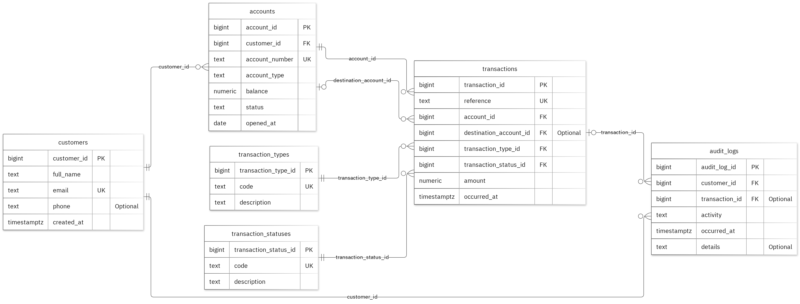

# MIT 8103 Advanced Database Systems

**FinTrust Customer and Financial Records** · Olupamilerin Fanawopo · Student ID 301865935

## Case study

This is FinTrust Customer and Financial Records. The database supports customers managing their accounts and transactions, customer support staff reviewing account activity, and database administrators maintaining records, with separate tables named customers, accounts, transaction_types, transaction_statuses, transactions and audit_logs. 
It supports these operations: register customers and open accounts; record deposits, withdrawals and transfers; track transaction types and statuses; review financial activity and audit records.

## Portfolio 1: Database Design and Modelling

I organised the relational design into 6 tables. Primary keys identify records, foreign keys preserve the links, and checks enforce the stated business rules. An account balance cannot be below zero. The normalisation examples show the sample data at 1NF, 2NF and 3NF. All 48 deliberately invalid inserts were rejected without changing the valid sample rows.

Figure 1. Tables, keys and relationships. PK: primary key; FK: foreign key; UK: unique value.

<!-- PAGE BREAK -->

## Portfolio 2: Query Processing and Optimisation

I ran four SQL queries against the sample records. The join query returned one record, showing Alex Morgan's transaction with reference FT-100001. For the index comparison, I used 50,000 separate performance rows. The median lookup time changed from 2.4 ms to 0.282 ms. Both phases returned the same records. The measured plan used the new index. These timings apply to this lookup and environment.

## Portfolio 3: Transactions and Concurrency

I used a temporary counter on transactions to test COMMIT, ROLLBACK and READ COMMITTED isolation. The uncommitted update remained hidden from the other session, and ROLLBACK restored the earlier committed value. Without locking, two increments left the counter at 2. With SELECT FOR UPDATE, Session B waited for Session A and the final value was 3. The helper is confined to this exercise; the case's original business fields stay unchanged.

## Portfolio 4: NoSQL and Advanced Data Models

I used activity_events for the case's event documents. The MongoDB implementation used an activity_events collection to store sample event documents. I inserted two sample events and ran four queries successfully. I also tested the validation rules by attempting to insert an invalid date and a duplicate event ID. Both were rejected.

## Repository and evidence

https://github.com/Pamilerin-fanawopo/Fanawopo_Olupamilerin_301865935

The portfolio folders contain the SQL and JavaScript, explanations, query plans, result tables and screenshots.

<!-- PAGE BREAK -->

## Portfolio 5: Distributed and Cloud Database Exercise

I proposed three MongoDB replica members across separate failure zones. The discussion covers primary elections, majority acknowledgement, secondary lag and sharding trade-offs for activity_events. Replication supports availability, while backups address recovery. PostgreSQL needs its own availability plan. This is the permitted discussion option; no live replica set or failover test was deployed.

## Individual reflection

## Individual Reflection

This portfolio was a learning experience for me, especially because I was new to MySQL Workbench and had to learn as I built the database. From installing the tools to creating the tables, understanding their attributes and setting up relationships, I gradually became more confident with the process.
One thing I particularly learned was that database design requires careful thought. I had to understand why each table was needed, how the tables connected and how constraints could prevent incorrect records. I also had to go back and make corrections along the way to ensure the design worked as intended.
I'm glad I didn't just rush through the implementation. Taking time to understand each step has given me a better foundation in relational database design and more confidence to work with MySQL.

## AI-use declaration

I used GitHub Copilot and the portfolio generator to help prepare the database model, scripts and explanations. The generator ran the PostgreSQL and MongoDB exercises, checked their outputs and captured the result images.  I remain responsible for checking and explaining the submitted work.

## References

- [PostgreSQL: constraints](https://www.postgresql.org/docs/17/ddl-constraints.html)
- [PostgreSQL: EXPLAIN](https://www.postgresql.org/docs/17/using-explain.html)
- [PostgreSQL: isolation](https://www.postgresql.org/docs/17/transaction-iso.html)
- [PostgreSQL: row locks](https://www.postgresql.org/docs/17/explicit-locking.html)
- [MongoDB: data modelling](https://www.mongodb.com/docs/manual/data-modeling/)
- [MongoDB: replication](https://www.mongodb.com/docs/manual/replication/)
- [MongoDB: sharding](https://www.mongodb.com/docs/manual/sharding/)
- [Mermaid: ER diagrams](https://mermaid.js.org/syntax/entityRelationshipDiagram.html)

